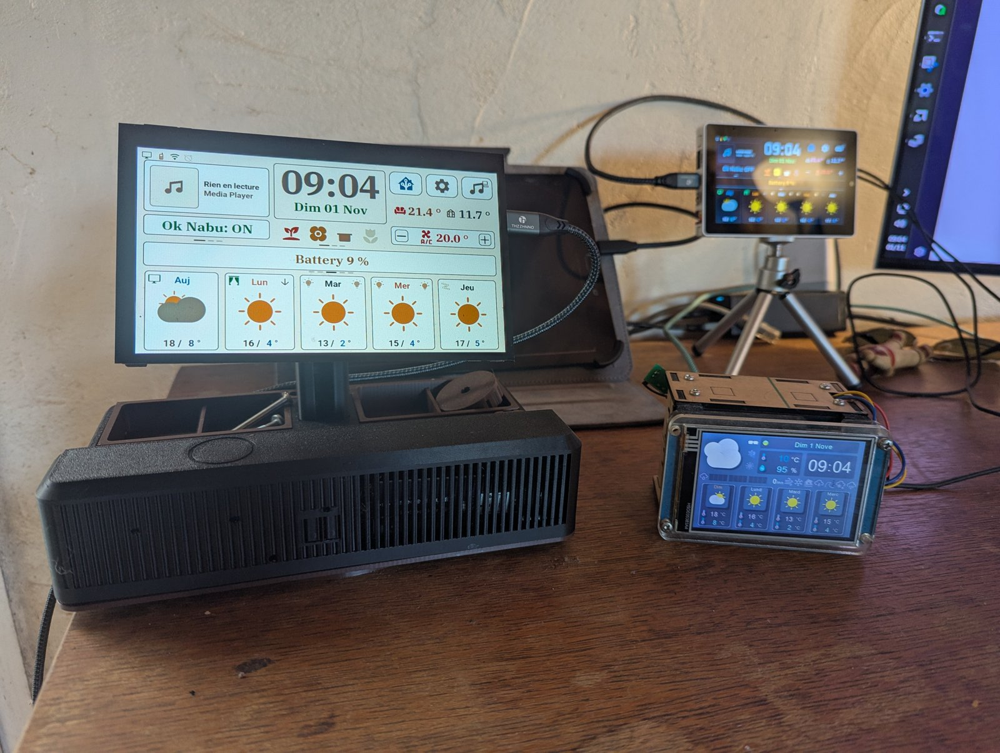
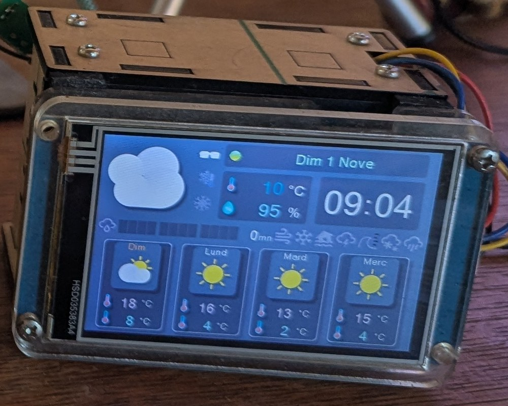

# Nextion Weather — Météo-France ☀️🌧️

> **Projet terminé (version finale 1.0.0, 01/11/2026).** Je suis passé aux écrans LVGL de mon projet [M5-Tab5-ESPHome-LVGL](https://github.com/Axellum/M5-Tab5-ESPHome-LVGL). Ce dépôt reste en ligne tel quel. Il marche chez moi, mais je n'y ajouterai plus rien.

Un petit écran Nextion qui affiche la météo de Météo-France : temps actuel, vigilance du département, pluie dans l'heure, prévisions sur 9 jours et heure par heure. Un ESP32 le pilote, Home Assistant lui envoie les données.

C'est l'écran météo de mon salon, partagé au cas où il servirait à quelqu'un. Le code a été écrit en grande partie avec l'IA (Gemini, puis Claude) et n'a été testé que chez moi.

## Ce que montre l'écran

- La date et l'heure (l'ESP les prend sur Internet, sans Home Assistant).
- Le temps actuel : icône, température, humidité.
- Les risques de gel, de neige, de pluie et l'indice UV (si vous avez les capteurs).
- La vigilance Météo-France du département, par type (vent, orages, inondation…).
- La pluie dans l'heure, par tranches de 5 minutes.
- Les prévisions : 4 jours sur l'accueil, 9 jours et 8 heures sur les autres pages (balayage ou boutons de l'écran).

 

## Installation

**Matériel**
- Un écran Nextion 3,5" 480×320 (NX4832T035, ou son remplaçant NX4832F035 « Discovery »).
- Un ESP32. Ici, un Seeed Studio XIAO ESP32-S3.
- 4 fils.

| XIAO ESP32-S3 | Nextion |
|---|---|
| D6 (GPIO43, TX) | RX |
| D7 (GPIO44, RX) | TX |
| 5V | 5V |
| GND | GND |

**Étapes**
1. Copiez `nextion/NextionWeather 3.5.tft` sur une carte micro-SD, insérez-la dans l'écran, mettez-le sous tension, puis retirez la carte une fois la copie finie.
2. Dans ESPHome, créez un appareil avec [`esphome/nextion-meteo.yaml`](esphome/nextion-meteo.yaml) et [`esphome/nextion_meteo.h`](esphome/nextion_meteo.h), à mettre dans le même dossier.
   - Mettez `wifi_ssid`, `wifi_password` et `api_encryption_key` dans vos secrets. La mise à jour par le Wi-Fi est chiffrée avec la même clé.
   - Flashez, puis ajoutez l'appareil dans Home Assistant.
3. Installez l'intégration officielle **Météo-France** dans Home Assistant.
4. Importez le blueprint : 
   - Créez une automatisation avec, puis choisissez l'écran, la ville, et si vous voulez la vigilance, la pluie dans l'heure et les probabilités.
   - Changer de ville se fait dans l'automatisation, sans recompiler.

Le fichier `NextionWeather 2.8.tft` est aussi là pour le Nextion 2,8" (320×240), mais je ne l'ai pas essayé avec ce firmware.

## Comment ça marche

Le firmware ne connaît aucune entité de Home Assistant. C'est le blueprint qui lit la météo et l'envoie à l'écran par des actions ESPHome (`maj_actuel`, `maj_alerte_meteo_france`, `maj_pluie_1h`, `maj_previsions_jours`, `maj_previsions_heures`).

L'écran est mis à jour :
- à chaque changement de la météo ;
- toutes les 5 minutes ;
- au démarrage de Home Assistant ;
- dès que l'écran se reconnecte : il envoie l'événement `esphome.nextion_meteo_connecte`, et le blueprint lui renvoie tout.

Mesuré chez moi le 01/11/2026 (XIAO ESP32-S3, firmware 1.0.0) :

| Mesure | Résultat |
|---|---|
| Envoi complet par Home Assistant (30 actions) | 77 ms (trace de l'automatisation) |
| Envoi des ~96 commandes sur la liaison série, à 115 200 bauds | ~0,23 s (calculé, pas mesuré) |
| Redémarrage de l'ESP → premier envoi de HA | 3,3 à 6,1 s (3 redémarrages ; l'écart vient du moment où HA se reconnecte) |

Un comparatif avec les autres écrans que j'utilise (Nextion 2,8", Tab5, Waveshare 7") est dans [`docs/comparatif-ecrans.md`](docs/comparatif-ecrans.md).

## Les anciennes versions

Le projet a eu quatre architectures. Seule celle-ci (la V2, « Service Push ») est maintenue. Les autres sont rangées dans [`archives/`](archives/README.md), telles quelles :
- **V1** : Home Assistant crée ~130 capteurs « template », qu'ESPHome affiche.
- **V3** : ESP32 autonome sous Arduino, avec l'API Open-Meteo. Sans Home Assistant, mais sans vigilance ni pluie dans l'heure.
- **V4** : ESP32 autonome sous Arduino, qui interroge directement l'API de l'application Météo-France. Fragile : elle cassera si le jeton change.

## Mises en garde

- Le 01/11/2026 : nettoyage du dépôt avec Claude. La V2 a désormais un blueprint et un firmware sans entité Home Assistant. Elle est testée tous les jours chez moi sur un Nextion 3,5".
- Le 09/03/2026: Le projet passe sur Antigravity... Et du coup l"IA a fais deux trois changements ( 100% du code vient de Gemini... Ainsi que la présentation :) ). Je test la V2 actuellement, pas encore tester les version sans HA.
- Le 15/07/2024: Remise en marche des prévisions suite au changement de l'API et débug des titres des prévisions journaliére. Bref, la version 3.5 remarche!
- En partant du principe qu'il est plus judicieux de partie de ce projet pour le compléter ensuite, j'ai indexer 100 (99 sur l'index Nextion) images pour facilitée d'autres intégrations.
- Le codage est à l'effigie de mon orthographe, fais de brique et de broc.

---
*Conception : **Axell**. Aide et conseils de pbranly et Nico_206 sur hacf.fr. Code écrit avec Gemini (Antigravity) puis Claude.*
