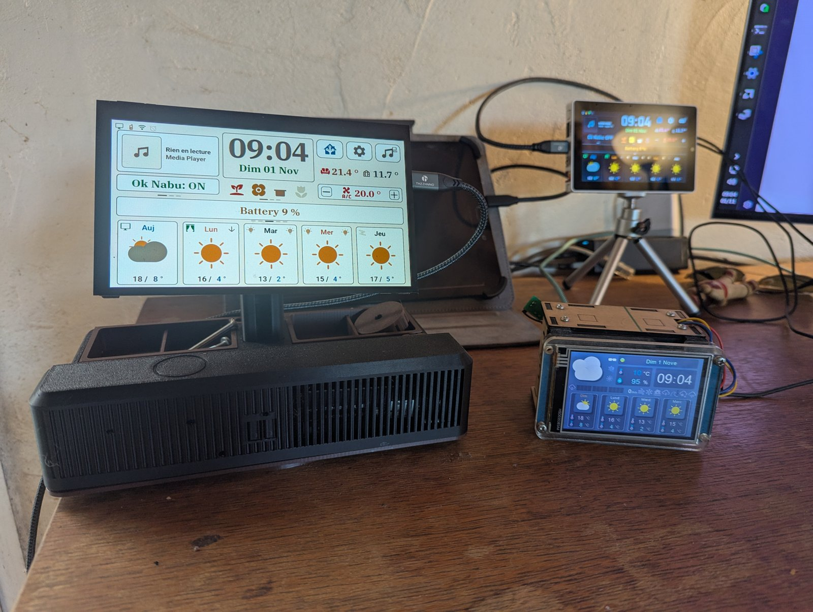

# Comparatif des écrans

Les quatre écrans que j'utilise avec Home Assistant :
- les deux Nextion de ce dépôt ;
- les deux écrans ESP32-P4 de mon autre projet, [M5-Tab5-ESPHome-LVGL](https://github.com/Axellum/M5-Tab5-ESPHome-LVGL).

Ce n'est pas un banc d'essai : chaque chiffre dit d'où il vient. Ceux de la vitesse n'ont pas été pris avec la même méthode d'un écran à l'autre.

## En bref

| | Nextion 2,8" | Nextion 3,5" | M5Stack Tab5 | Waveshare ESP32-P4 7B |
|---|---|---|---|---|
| Dalle | 2,8", 320×240 | 3,5", 480×320 | 5", 1280×720 IPS | 7", 1024×600 IPS |
| Tactile | résistif | résistif | capacitif | capacitif 5 points |
| Ce qui calcule | l'ESP32 à côté (XIAO ESP32-S3) | l'ESP32 à côté (XIAO ESP32-S3) | ESP32-P4 intégré | ESP32-P4 intégré |
| Prix (lu le 01/11/2026) | non vérifié (~26-30 € chez les revendeurs) + XIAO 7,49 $ | 39,90 $ (Basic NX4832T035) ou 29,90 $ (Discovery NX4832F035) + XIAO 7,49 $ | non vérifié (boutique M5Stack illisible ce jour-là) | 46,99 $, 55,99 $ avec caméra |
| Installation | carte SD pour l'écran, ESPHome à compiler, 4 fils, blueprint | pareil | firmware depuis le navigateur, blueprint | pareil |
| Ce qu'il affiche | météo | météo | tableau de bord complet (météo, lumières, chauffage, musique, caméras, jeux…) | pareil, sans les jeux par défaut |
| Firmware | ce dépôt (pas essayé avec la V2) | ce dépôt | M5-Tab5-ESPHome-LVGL | M5-Tab5-ESPHome-LVGL |

## Vitesse

| | Nextion 3,5" | M5Stack Tab5 | Waveshare 7B |
|---|---|---|---|
| Envoi complet par Home Assistant | 77 ms (30 actions) | non repris ici | non repris ici |
| Démarrage | ~6 s du redémarrage de l'ESP à l'écran rempli (01/11/2026) | API de nouveau joignable 17,2 à 17,4 s après le bouton de redémarrage (07/10/2026, thème Ardoise) | première image ~4,8 s, Wi-Fi ~9,4 s (17/10/2026) |
| Source | mesures du 01/11/2026, traces de l'automatisation | [performance.md](https://github.com/Axellum/M5-Tab5-ESPHome-LVGL/blob/main/docs/performance.md) du projet Tab5 | [performance.md](https://github.com/Axellum/M5-Tab5-ESPHome-LVGL/blob/main/docs/performance.md) du projet Tab5 |

Le Nextion démarre vite parce qu'il ne fait presque rien : les images sont déjà dans l'écran, l'ESP ne lui envoie que des numéros d'image et des textes, environ 2,6 Ko en tout. Les écrans ESP32-P4 dessinent tout eux-mêmes, à bien plus haute résolution.

## En résumé

- **Nextion** : petit, pas cher, tout simple. Bien pour un écran qui ne fait que la météo. En revanche, la dalle est résistive et de faible résolution, et chaque changement de l'affichage passe par le Nextion Editor (Windows) et une carte SD.
- **Tab5 et Waveshare 7B** : de vrais tableaux de bord tactiles, nets, et qui se règlent depuis Home Assistant. Ils coûtent plus cher, et le firmware est bien plus gros.

## Sources des fiches

- Nextion : [NX4832T035](https://nextion.tech/datasheets/nx4832t035/), [NX4832F035](https://nextion.tech/datasheets/nx4832f035/), [NX3224T028](https://nextion.tech/datasheets/nx3224t028/)
- [Seeed XIAO ESP32-S3](https://www.seeedstudio.com/XIAO-ESP32S3-p-5627.html)
- [M5Stack Tab5](https://docs.m5stack.com/en/core/Tab5)
- [Waveshare ESP32-P4-WIFI6-Touch-LCD-7B](https://www.waveshare.com/esp32-p4-wifi6-touch-lcd-7b.htm)
